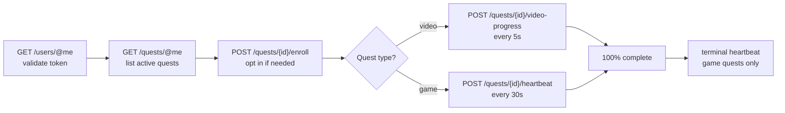

<div align="center">

# Discord Quests Bot

**Complete your Discord quests automatically - one click, every reward.**

[](LICENSE)
[](https://github.com/DevonNetwork/Discord-Quests-Bot/actions/workflows/ci.yml)
[](https://bun.sh)
[](https://www.typescriptlang.org)
[](https://discord.js.org)

</div>

Discord Quests Bot is a self-hosted Discord bot that drives your account's quests to 100% for you. Run `/quests`, follow the private prompt, and pick a single quest or sweep every active one - the bot reports progress in your DMs and stops cleanly whenever you tell it to.

The quest engine lives in its own module with **zero discord.js dependency**, so you can run the bot as-is or embed the engine in your own projects.

---

## ✨ Features

- **Quest browser** - page through every active quest with **Back** and **Next**, see its art, reward, and progress, then press **Confirm** to run it. Completed quests stay out of the way until you press **Show completed**. **Complete all quests** sweeps the rest.
- **Private quest runs** - every interaction reply is ephemeral, and the bot DMs you as each quest finishes with a summary when the run ends. Set `DM_QUEST_UPDATES=false` in `.env` to use the in-channel progress bar instead.
- **Full quest coverage** - video quests (watch trailers) and game quests (desktop, Xbox, PlayStation, streaming, play activity) are all automated.
- **Production-grade API client** - per-route rate limiting, 429 backoff, transient-failure retries, request timeouts, and typed errors.
- **Resilient automation** - stall detection abandons quests that stop progressing instead of hanging the batch; one failing quest never blocks the rest.
- **Private by design** - tokens are validated, held in memory for the session, and dropped when the run ends. Nothing is stored, logged, or sent anywhere but discord.com.

## 🚀 Getting started

### Prerequisites

- [Bun](https://bun.sh) **v1.1+**
- A Discord application with a bot token (create one in the [developer portal](https://discord.com/developers/applications))

The Windows setup script in `scripts/user` installs Node.js, Bun, and the project dependencies for you, so you can skip the manual Bun install.

### Installation

#### Windows

1. [Download the repository as a ZIP](https://github.com/DevonNetwork/Discord-Quests-Bot/archive/refs/heads/main.zip) and extract it, or clone it with Git.
2. Open the `scripts\user` folder and double-click **`install.bat`**. It checks for Node.js and Bun, installs whichever is missing, installs the project dependencies, and creates your `.env` file.
3. Open `.env` in Notepad and paste your bot token after `DISCORD_TOKEN=`.
4. Double-click **`run.bat`** to start the bot. Keep its window open while the bot is running.

> [!NOTE]
> The setup script uses `winget` to install Node.js. If `winget` is unavailable, install Node.js from [nodejs.org](https://nodejs.org) and run `install.bat` again.

#### macOS and Linux

```sh
git clone https://github.com/DevonNetwork/Discord-Quests-Bot.git
cd Discord-Quests-Bot
bun install
```

### Configuration

The Windows setup script creates `.env` for you. Otherwise, copy the example
environment file and fill in your bot token:

```sh
cp .env.example .env
```

| Variable    | Required | Description                                                                                          |
| ----------- | :------: | ---------------------------------------------------------------------------------------------------- |
| `DISCORD_TOKEN` | ✅ | Bot token from the Discord developer portal                                                          |
| `GUILD_ID`  | ❌ | Register commands in one guild for instant availability during development; leave empty for global registration |

Feature toggles are read from `.env`; their defaults live in `src/config.ts`. `DM_QUEST_UPDATES` is enabled by default and sends quest completion updates by DM; set it to `false` to use the in-channel progress embed instead. `DASHBOARD_ENABLED` is disabled by default and registers the admin-only `/dashboard` command when set to `true`. Accepted values are `true` or `false`.

The public dashboard language is controlled by `dashboardLanguage` in `src/config.ts`. It defaults to `'ar'` (Arabic); set it to `'en'` for English.

### Running

```sh
bun run dev                 # development, with file watching
bun run start               # production
bun run check               # typecheck + lint + tests
bun run check:build-number  # verify Discord's live client build number
```

The individual quality commands are `bun run typecheck`, `bun run lint`, and
`bun test`.

### Docker

Build the image and run the container with your `.env` file:

```sh
docker build -t discord-quests-bot .
docker run -d --name discord-quests-bot --restart unless-stopped --env-file .env discord-quests-bot
```

Follow the logs with `docker logs -f discord-quests-bot`, stop the bot with
`docker stop discord-quests-bot`, and start it again with
`docker start discord-quests-bot`. The image contains only the runtime
dependencies, and your `.env` file stays on the host.

## 🤖 Usage

1. Run **`/quests`** in any server the bot is in.
2. Paste your **Discord user token** into the modal.
3. The bot shows your quests privately, one at a time, with the game art, reward, expiry, and progress.
4. Use **Back** and **Next** to browse, then press **Confirm** to complete the quest you picked, or **Complete all quests** to run every supported one. Finished quests are hidden by default; press **Show completed** to browse them at the end of the list.
5. The bot DMs you as each quest finishes and sends a summary when the run ends. Press **Stop** from the start message or the DM whenever you like. If your DMs are closed, the bot falls back to a private progress embed.
6. Claim your rewards in the Discord client and enjoy.

### Dashboard

Set `DASHBOARD_ENABLED=true` in `.env` and restart the bot to register the `/dashboard` command. An administrator can run it in a channel to post a persistent embed with a **Get Started** button. Anyone in that channel can press the button, follow the private prompt, and use the same quest browser without running a slash command. Every reply in that flow is private, and quest completion updates arrive by DM.

The embed is posted in Arabic by default. The **English version** button opens the same embed in English for that user, and the **النسخة العربية** button switches back. Set `dashboardLanguage` to `'en'` to make English the default instead.

> [!NOTE]
> The `/dashboard` command requires the **Administrator** permission, but the button in the posted embed is available to everyone who can see the channel.

> [!NOTE]
> Rewards are not claimed automatically. When a quest hits 100%, open the Discord client and claim it from your quest page like you normally would.

## ⚙️ How it works

Discord tracks quest progress server-side through undocumented endpoints normally driven by the desktop client. Given a user token, the engine speaks to those endpoints directly:



- **Video quests** (`WATCH_VIDEO`, `WATCH_VIDEO_ON_MOBILE`) report a timestamp that advances with the wall clock.
- **Game quests** (`PLAY_ON_DESKTOP`, `PLAY_ON_XBOX`, `PLAY_ON_PLAYSTATION`, `STREAM_ON_DESKTOP`, `PLAY_ACTIVITY`) report an application ID and executable path, resolved from Discord's public application directory and cached per game.
- **Game sessions end** with a `terminal: true` heartbeat, matching what the real client sends when a game closes.

Quests with tasks outside this list are displayed in the quest list but skipped by the automation.

## 📁 Project structure

```
src/
├── api/            REST client for user-token requests
│   ├── build-number.ts runtime client build number resolver
│   ├── client.ts       rate limiting, retries, timeouts
│   ├── errors.ts       typed API errors
│   ├── fingerprint.ts  desktop client headers / x-super-properties
│   └── token.ts        token shape checks and validation
├── bot/            Discord bot layer (discord.js)
│   ├── commands.ts     slash command registration
│   ├── embeds.ts       embed builders for the quest UI
│   ├── flow.ts         interaction handling and run orchestration
│   └── registry.ts     per-user setup and run state
├── quest/          Quest engine - no discord.js dependency
│   ├── complete.ts     batch orchestration with hooks
│   ├── executables.ts  game executable resolution
│   ├── quest.ts        quest model and progress queries
│   ├── runner.ts       heartbeat / video-progress loop
│   └── tasks.ts        supported task registry and pacing
├── util/           Small shared helpers
├── config.ts       environment configuration and feature toggles
└── index.ts        entry point

tests/
├── api/            mirrors src/api
├── bot/            mirrors src/bot
├── quest/          mirrors src/quest
├── testing/        shared test infrastructure (scripted API client)
├── util/           mirrors src/util
└── config.test.ts

scripts/
├── check-build-number.ts
└── user/           Windows setup and run helpers
```

Tests live in `tests/` at the repository root and mirror the source layout, so
`src/` stays focused on runtime code. Run them with `bun test`.

## ❓ FAQ

<details>
<summary><b>Where do I find my Discord user token?</b></summary>

Open the Discord client, press <kbd>Ctrl</kbd>+<kbd>Shift</kbd>+<kbd>I</kbd> to open developer tools, go to the <b>Network</b> tab, and copy the <code>authorization</code> header value from any request to discord.com.
</details>

<details>
<summary><b>Is my token safe?</b></summary>

The token is validated against the API, kept in memory only for the duration of your session, and dropped as soon as the run ends. It is never persisted to disk, never logged, and never sent anywhere other than discord.com. The bot needs no database and stores no state.
</details>

<details>
<summary><b>Why is a quest skipped?</b></summary>

Only the task types listed above can be automated. Quests that require purchases, in-client clicks, or other unsupported actions are shown in the list but excluded from the batch.
</details>

<details>
<summary><b>What happens if a quest gets stuck?</b></summary>

A game quest that reports no progress for 8 minutes is considered stalled, abandoned, and logged in the summary - the rest of the batch keeps running. Repeated API failures fail the individual quest the same way.
</details>

## 🤝 Contributing

Contributions are welcome! Please open an issue to discuss bigger changes before submitting a pull request.

```sh
bun install
bun run check   # typecheck + lint + tests
```

See [CONTRIBUTING.md](CONTRIBUTING.md) for the full workflow, code expectations, and test setup. Security issues should be reported privately as described in [SECURITY.md](SECURITY.md).

## ⚠️ Disclaimer

Automating a user account violates the [Discord Terms of Service](https://discord.com/terms) and can lead to the account being suspended. This project exists for educational purposes - use it at your own risk, ideally on an account you can afford to lose.

## 📄 License

Distributed under the [Apache-2.0](LICENSE) license.
