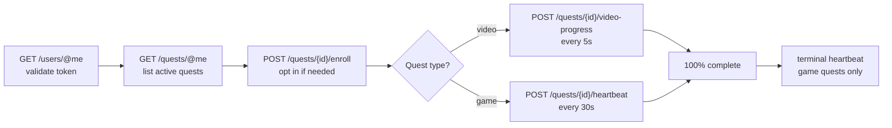

<div align="center">

# Discord Quests Bot

**Complete your Discord quests automatically - one click, every reward.**

[](LICENSE)
[](https://github.com/DevonNetwork/Discord-Quests-Bot/actions/workflows/ci.yml)
[](https://bun.sh)
[](https://www.typescriptlang.org)
[](https://discord.js.org)

</div>

Discord Quests Bot is a self-hosted Discord bot that drives your account's quests to 100% for you. Run `/quests`, paste your token, and pick a single quest or sweep every active one - the bot reports live progress in a channel embed and stops cleanly whenever you tell it to.

The quest engine lives in its own module with **zero discord.js dependency**, so you can run the bot as-is or embed the engine in your own projects.

---

## ✨ Features

- **One-click completion** - finish a single quest from a menu, or press **Complete all** and let the batch run through everything.
- **Live progress embeds** - a throttled, rate-limit-safe progress bar updates in real time; stop at any moment mid-heartbeat.
- **Full quest coverage** - video quests (watch trailers) and game quests (desktop, Xbox, PlayStation, streaming, play activity) are all automated.
- **Production-grade API client** - per-route rate limiting, 429 backoff, transient-failure retries, request timeouts, and typed errors.
- **Resilient automation** - stall detection abandons quests that stop progressing instead of hanging the batch; one failing quest never blocks the rest.
- **Private by design** - tokens are validated, held in memory for the session, and dropped when the run ends. Nothing is stored, logged, or sent anywhere but discord.com.

## 🚀 Getting started

### Prerequisites

- [Bun](https://bun.sh) **v1.1+**
- A Discord application with a bot token (create one in the [developer portal](https://discord.com/developers/applications))

### Installation

```sh
git clone https://github.com/DevonNetwork/Discord-Quests-Bot.git
cd Discord-Quests-Bot
bun install
```

### Configuration

Copy the example environment file and fill in your bot token:

```sh
cp .env.example .env
```

| Variable    | Required | Description                                                                                          |
| ----------- | :------: | ---------------------------------------------------------------------------------------------------- |
| `DISCORD_TOKEN` | ✅ | Bot token from the Discord developer portal                                                          |
| `GUILD_ID`  | ❌ | Register commands in one guild for instant availability during development; leave empty for global registration |

### Running

```sh
bun run dev        # development, with file watching
bun run start      # production
bun run check      # typecheck + lint + tests
```

The individual quality commands are `bun run typecheck`, `bun run lint`, and
`bun test`.

## 🤖 Usage

1. Run **`/quests`** in any server the bot is in.
2. Paste your **Discord user token** into the modal.
3. The bot replies with your active quests and how far along each one is.
4. Pick a quest from the menu - or press **Complete all**.
5. Watch the progress embed, press **Stop** whenever you like.
6. Claim your rewards in the Discord client and enjoy.

> [!NOTE]
> Rewards are not claimed automatically. When a quest hits 100%, open the Discord client and claim it from your quest page like you normally would.

## ⚙️ How it works

Discord tracks quest progress server-side through undocumented endpoints normally driven by the desktop client. Given a user token, the engine speaks to those endpoints directly:



- **Video quests** (`WATCH_VIDEO`, `WATCH_VIDEO_ON_MOBILE`) report a timestamp that advances with the wall clock.
- **Game quests** (`PLAY_ON_DESKTOP`, `PLAY_ON_XBOX`, `PLAY_ON_PLAYSTATION`, `STREAM_ON_DESKTOP`, `PLAY_ACTIVITY`) report an application ID and executable path, resolved from Discord's public application directory and cached per game.
- **Game sessions end** with a `terminal: true` heartbeat, matching what the real client sends when a game closes.

Quests with tasks outside this list are displayed in the quest list but skipped by the automation.

## 📁 Project structure

```
src/
├── api/            REST client for user-token requests
│   ├── client.ts       rate limiting, retries, timeouts
│   ├── errors.ts       typed API errors
│   ├── fingerprint.ts  desktop client headers / x-super-properties
│   └── token.ts        token shape checks and validation
├── bot/            Discord bot layer (discord.js)
│   ├── commands.ts     slash command registration
│   ├── embeds.ts       embed builders for the quest UI
│   ├── flow.ts         interaction handling and run orchestration
│   └── registry.ts     per-user setup and run state
├── quest/          Quest engine - no discord.js dependency
│   ├── complete.ts     batch orchestration with hooks
│   ├── executables.ts  game executable resolution
│   ├── quest.ts        quest model and progress queries
│   ├── runner.ts       heartbeat / video-progress loop
│   └── tasks.ts        supported task registry and pacing
├── util/           Small shared helpers
├── config.ts       environment configuration
└── index.ts        entry point

tests/
├── api/            mirrors src/api
├── bot/            mirrors src/bot
├── quest/          mirrors src/quest
├── testing/        shared test infrastructure (scripted API client)
├── util/           mirrors src/util
└── config.test.ts
```

Tests live in `tests/` at the repository root and mirror the source layout, so
`src/` stays focused on runtime code. Run them with `bun test`.

## ❓ FAQ

<details>
<summary><b>Where do I find my Discord user token?</b></summary>

Open the Discord client, press <kbd>Ctrl</kbd>+<kbd>Shift</kbd>+<kbd>I</kbd> to open developer tools, go to the <b>Network</b> tab, and copy the <code>authorization</code> header value from any request to discord.com.
</details>

<details>
<summary><b>Is my token safe?</b></summary>

The token is validated against the API, kept in memory only for the duration of your session, and dropped as soon as the run ends. It is never persisted to disk, never logged, and never sent anywhere other than discord.com. The bot needs no database and stores no state.
</details>

<details>
<summary><b>Why is a quest skipped?</b></summary>

Only the task types listed above can be automated. Quests that require purchases, in-client clicks, or other unsupported actions are shown in the list but excluded from the batch.
</details>

<details>
<summary><b>What happens if a quest gets stuck?</b></summary>

A game quest that reports no progress for 8 minutes is considered stalled, abandoned, and logged in the summary - the rest of the batch keeps running. Repeated API failures fail the individual quest the same way.
</details>

## 🤝 Contributing

Contributions are welcome! Please open an issue to discuss bigger changes before submitting a pull request.

```sh
bun install
bun run check   # typecheck + lint + tests
```

See [CONTRIBUTING.md](CONTRIBUTING.md) for the full workflow, code expectations, and test setup. Security issues should be reported privately as described in [SECURITY.md](SECURITY.md).

## ⚠️ Disclaimer

Automating a user account violates the [Discord Terms of Service](https://discord.com/terms) and can lead to the account being suspended. This project exists for educational purposes - use it at your own risk, ideally on an account you can afford to lose.

## 📄 License

Distributed under the [Apache-2.0](LICENSE) license.
